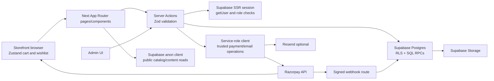

# System architecture — Sumam's Boutique

## Runtime and dependencies

| Concern | Current implementation |
|---|---|
| Web framework | Next.js 16.3 App Router; TypeScript; React 18 |
| UI | Tailwind CSS; server-rendered route components plus client components for interactive flows |
| Client state | Zustand cart/wishlist (`src/lib/store.ts`) |
| Validation | Zod schemas in `src/lib/schemas.ts` and `src/lib/admin/schemas.ts` |
| Database/API | Supabase PostgreSQL via `@supabase/supabase-js` and `@supabase/ssr`; SQL RPCs and migrations; no separate ORM/server API |
| Authentication | Supabase Auth SSR cookies; `src/proxy.ts` refreshes sessions; role checks in `src/lib/admin/auth.ts` and RLS |
| Media | Supabase Storage plus local `public/` assets; `next/image` remote patterns for Supabase |
| Payment | Razorpay Checkout.js, server-created Razorpay orders, HMAC callback verification, signed webhook route |
| Email | Optional Resend sender in `src/lib/email.ts` |
| Analytics | Optional Google Analytics 4 |
| Hosting | Deployment documentation targets Vercel and Docker standalone; no hosting account inspected |
| Quality/CI | ESLint, TypeScript, Vitest, Next build, GitHub Actions; no E2E runner configured |

## Data flow

## Trust boundaries

- Browser state, request parameters, form payloads, headers, client-calculated totals, and submitted database IDs are untrusted.
- Supabase anon/session clients rely on RLS and SQL authorization. `createAdminServerClient()` is a server-side cookie-aware client using the public anon key.
- `createServiceClient()` bypasses RLS. It is imported only by server modules for payments/email/webhook. Every use must have explicit session ownership or a verified provider event where the operation is customer-specific.
- Razorpay webhook events are accepted only after raw-body HMAC verification. Client callbacks use HMAC verification but require stronger order-owner authorization and sandbox evidence.
- Admin visibility is not the permission boundary; server actions and database policies must enforce role checks.

## Main workflows

- **Catalog:** App Router pages call `src/lib/data.ts`; Supabase products/categories/images/variants and content blocks are mapped to `CatalogProduct`; static `CATALOG` is used if backend data is missing/unavailable. Admin writes use server actions and RLS-protected Supabase calls.
- **Cart/checkout:** Client cart persists through Zustand; checkout requires a signed-in Supabase customer; `placeOrder()` validates a Zod payload then calls `create_pending_order` SQL RPC; totals/prices are computed from database rows/settings.
- **Payment:** `createRazorpayOrder()` reads pending order via service role, sends amount derived from DB total to Razorpay, and records Razorpay order reference. Callback or webhook verifies the signed payment event and calls `mark_order_paid`; SQL marks paid and runs inventory/coupon side effects.
- **Admin/CMS:** Admin route layout resolves a session; pages/actions call `requireAdminOrStaff`/`requireAdmin`; CMS stores structured JSON by section key in `content_blocks`; storefront `getHomeContent()` loads published records.
- **Account:** Account server actions use cookie-aware Supabase SSR client for profile, address, order list, review, password/email/avatar workflows. RLS/RPCs enforce ownership.

## Important environment-variable names

Public: `NEXT_PUBLIC_SUPABASE_URL`, `NEXT_PUBLIC_SUPABASE_ANON_KEY`, `NEXT_PUBLIC_RAZORPAY_KEY_ID`, `NEXT_PUBLIC_SITE_URL`, `NEXT_PUBLIC_GA_MEASUREMENT_ID`.

Server-only: `SUPABASE_SERVICE_ROLE_KEY`, `RAZORPAY_KEY_ID`, `RAZORPAY_KEY_SECRET`, `RAZORPAY_WEBHOOK_SECRET`, `RESEND_API_KEY`, `EMAIL_FROM`, `ADMIN_HOST`.

Only names are listed. No secret values are reproduced. `.env.local` exists in the workspace and is not inspected or printed by this report.

## Operations and failure behavior

- No queue, worker, cron scheduler, shipping carrier adapter, or Sentry integration is established.
- Product/content fallback can serve a local/static catalog after Supabase errors. This must not be confused with a live order/payment source of truth.
- Several dashboard queries catch failures and show empty/zero/demo fallback values. Operational UI should distinguish unavailable data from genuine zero values.
- Health route currently returns process-level status only; it does not probe Supabase, Razorpay, or email.
- The data cache is process-local and has a 60-second TTL; admin invalidation is also process-local.
- Migration guidance is documented in `supabase/migrations/README.md` and `docs/OPERATIONS.md`; it distinguishes local/staging/production and explicitly warns that the configured live database must not be used for unverified migrations.
